# SmartAttend - Enterprise Attendance System

SmartAttend is an enterprise-grade attendance management platform designed for modern educational institutions and organizations. It combines a robust **Laravel 12** backend with a dynamic **React 19 (Inertia.js V2)** frontend, **Tailwind CSS v4**, a dedicated **Python Face Recognition Microservice**, and an end-to-end **Dockerized deployment**.

Designed for high-speed, contactless biometric attendance via **ESP32-CAM** hardware devices with hardware-triggered capture and dynamic working-schedule calculations.

---

## 📸 Interface Showcase

| Login Gateway (RFID & Account) | Registration & Password Meter |
| :---: | :---: |
|  |  |
| *Unified authentication supporting physical RFID cards and credentials.* | *Registration with zxcvbn password meter and role hierarchy selection.* |

| Academic Studio Dashboard | Command Center Dashboard |
| :---: | :---: |
|  | 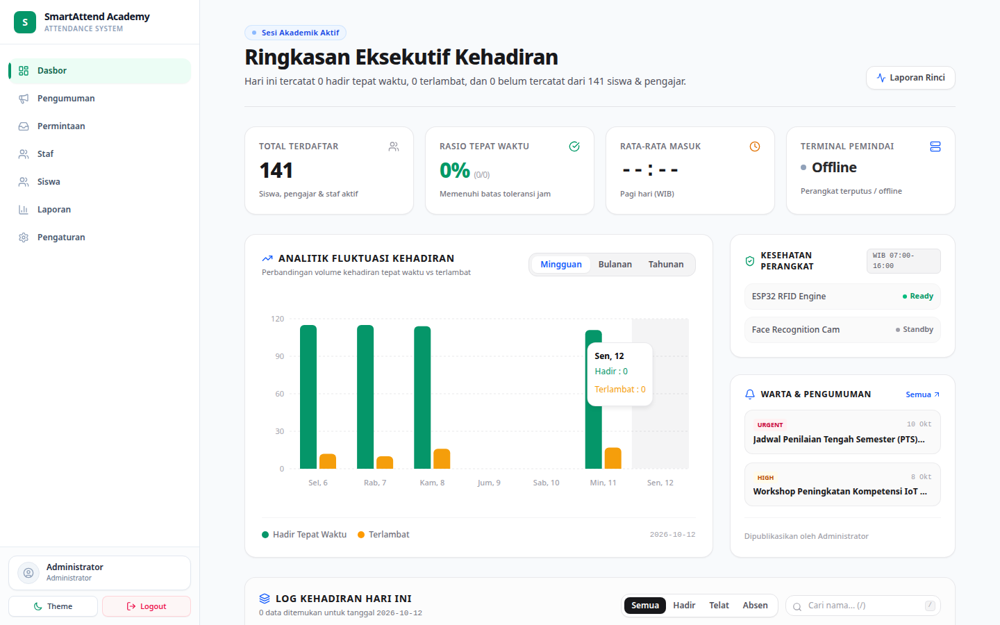 |
| *Visual analytics, weekly fluctuation chart, and device health monitor.* | *High-density telemetry view with real-time streaming activity logs.* |

| Staff Directory (`/profiles`) | Staff Profile Dossier (Modal View) |
| :---: | :---: |
| 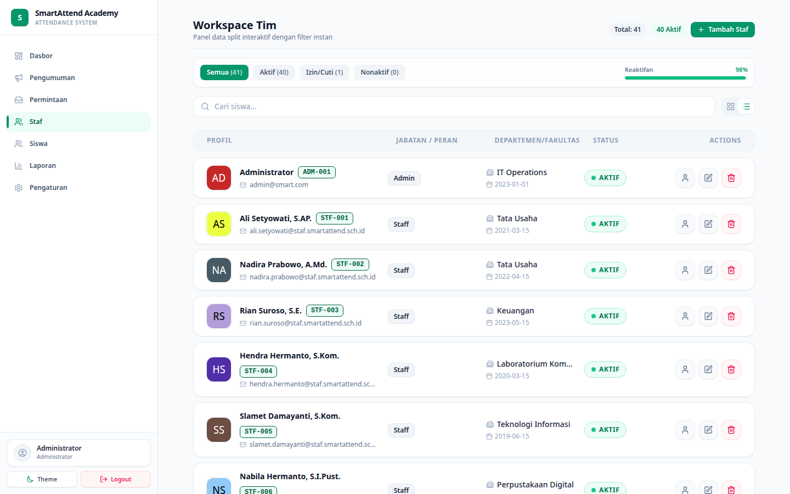 | 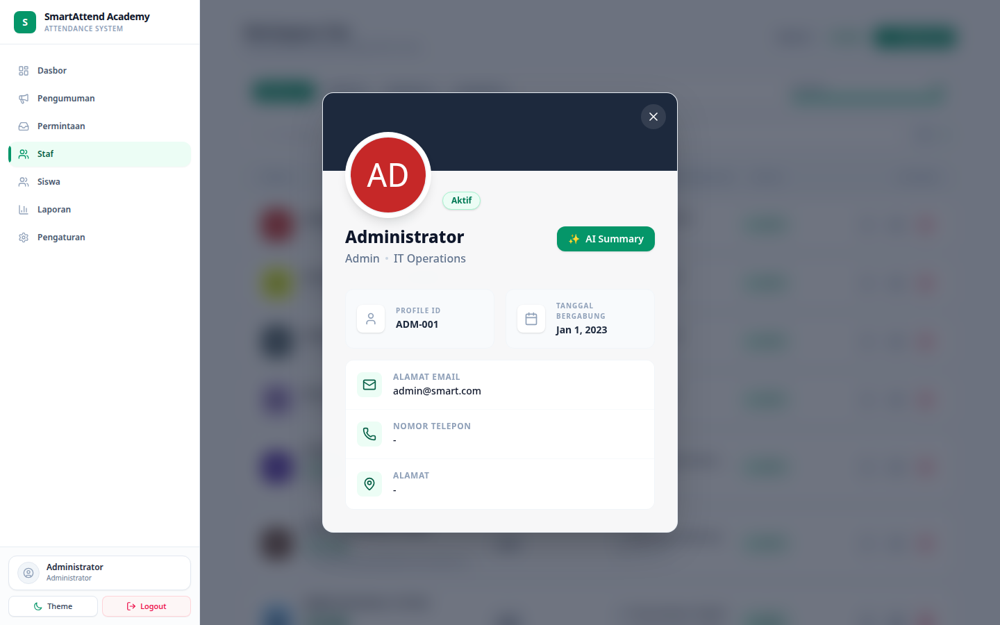 |
| *Management of teachers and administrative personnel with biometric status.* | *Detailed modal dossier with institutional ID, contact, and AI analysis.* |

| Student Directory (`/students`) | Student Profile Dossier (Modal View) |
| :---: | :---: |
| 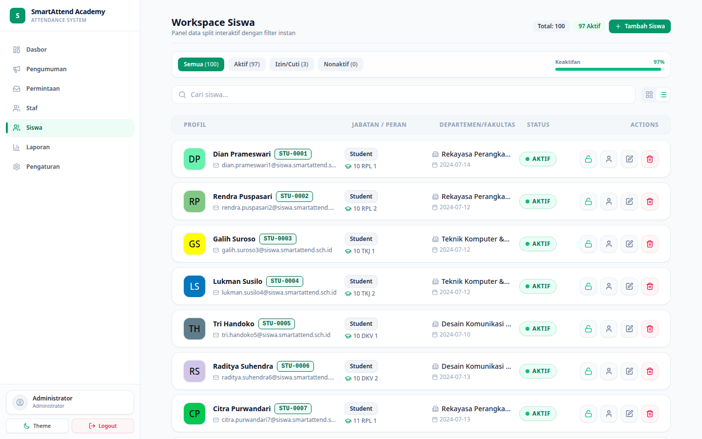 | 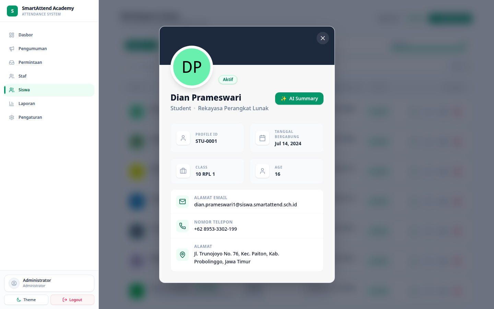 |
| *Class cohorts, age, attendance records, and student profiles.* | *Dossier view with Student ID (NIS), class grouping, and address.* |

| Reports & Gemini AI Analytics (`/reports`) | Leave & Permission Requests (`/requests`) |
| :---: | :---: |
| 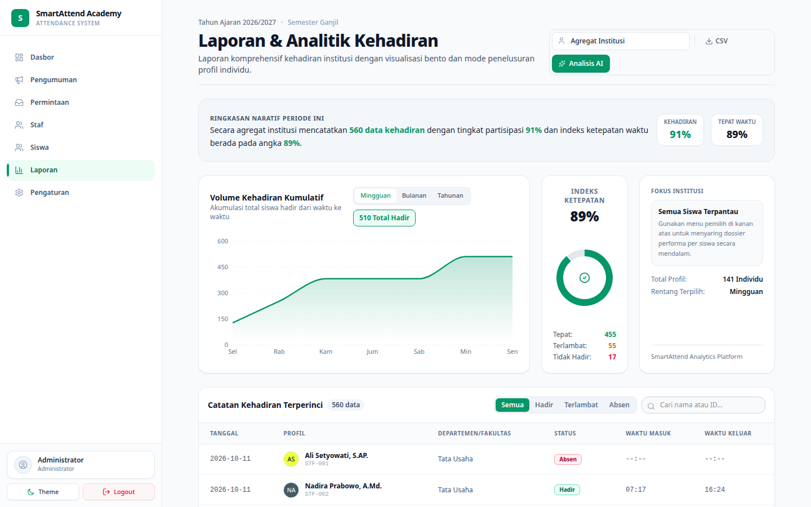 | 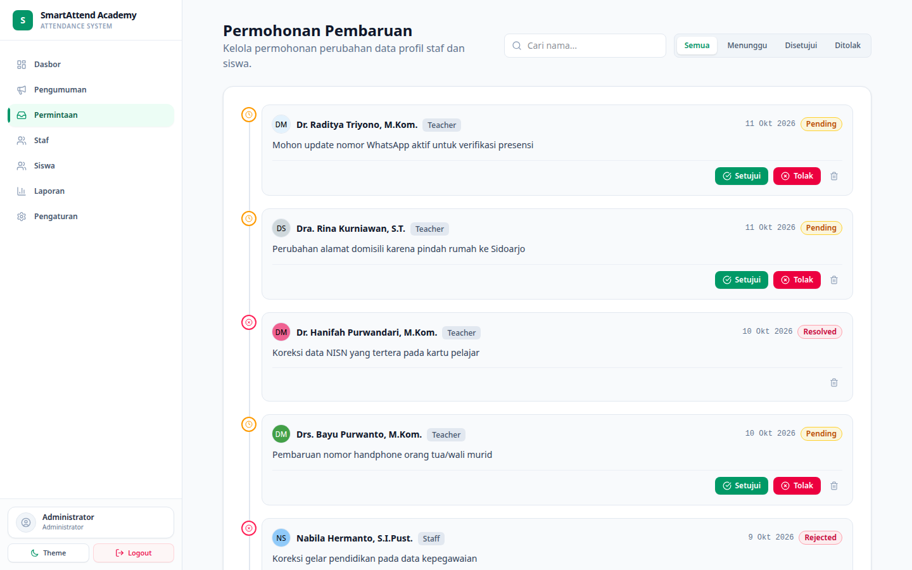 |
| *Cumulative attendance trends and textual insights generated by Google GenAI.* | *Transparent submission, review, and approval workflows.* |

| Institutional Announcements (`/announcements`) | Working Schedule Settings (`/settings`) |
| :---: | :---: |
| 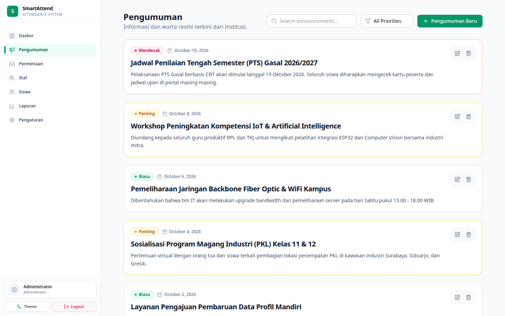 |  |
| *Broadcasts with urgency badges (Urgent, High, Normal).* | *Configurable weekly operating hours, grace thresholds, and locale.* |

| Admin Personal Profile (`/profile`) | Staff Personal Profile (Teacher View) |
| :---: | :---: |
| 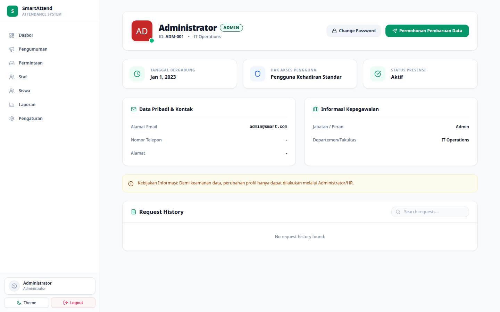 | 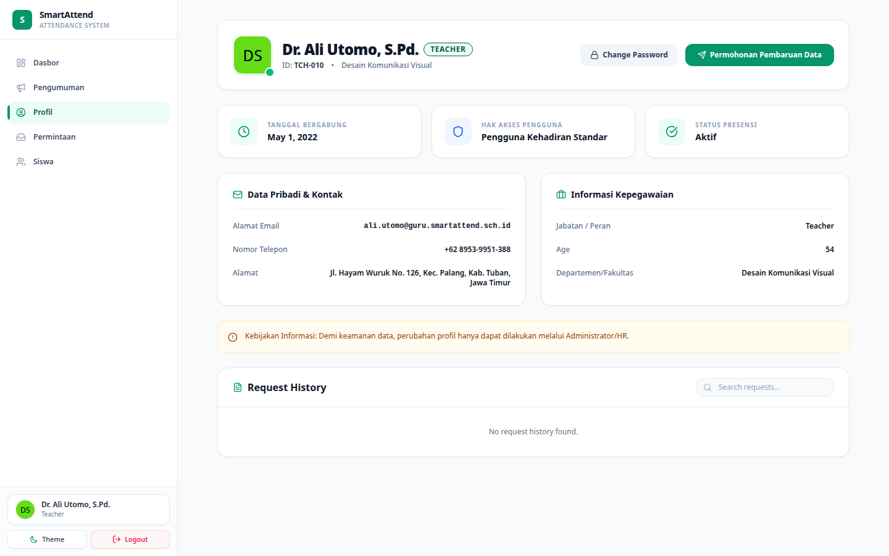 |
| *Self-service credential management for system administrators.* | *Teacher view displaying institutional assignments and permissions.* |

| Student Dashboard (Restricted View) | Student Personal Profile (`/profile`) |
| :---: | :---: |
| 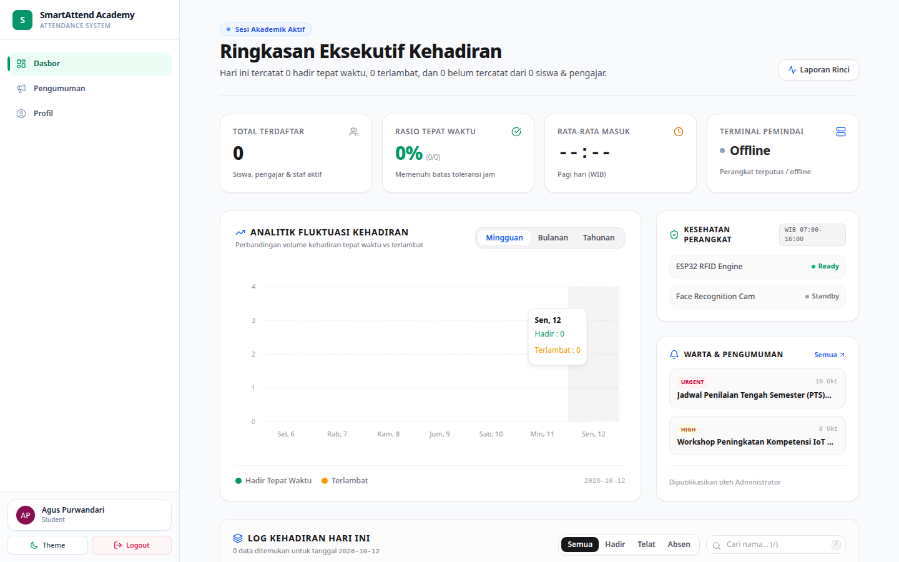 | 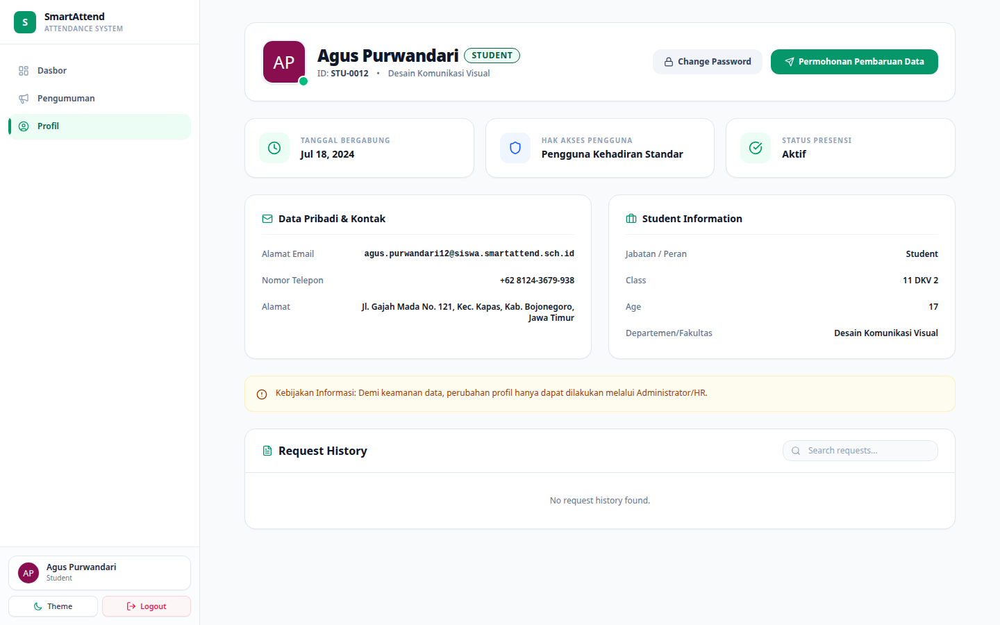 |
| *Spatie RBAC student view restricting access to authorized modules.* | *Individual student profile showing enrolled class and request history.* |

---

## 🌟 Key Features

### 1. Advanced Biometric Attendance & AI Vision
* **Contactless Face Recognition**: Automated biometric attendance using ESP32-CAM and a high-accuracy Python engine (Dlib HOG / OpenCV).
* **Auto-Enrollment & Validation**: Face uploads are validated in real-time, saved directly to `/python_service/known_faces`, and cached into `.pkl` encodings.
* **Microservice Health Check**: Real-time status monitoring (`/health`) with live UI indicator and loaded facial encodings count.
* **Hardware-Triggered ESP32-CAM**: Hardware button / PIR-activated frame capture to eliminate network flooding, featuring brownout protection for voltage stability.

### 2. Multi-Variant Dashboard & Theme Customization
* **5 Specialized Dashboard Views**:
  * **Academic Studio**: Geared towards educational analytics, class attendance, and student performance.
  * **Command Center**: High-density operational overview with real-time logs and system telemetry.
  * **Nordic Minimal**: Clean, distraction-free typographic layout for rapid scanning.
  * **Kiosk Monitor**: Large, high-visibility layout ideal for attendance kiosks and wall-mounted tablets.
  * **Status Workspace**: Task- and request-driven interface for daily administrative actions.
* **Dynamic Color Themes & Dark Mode**: Instant switching across custom palettes (`Emerald`, `Indigo`, `Amber`, `Rose`) with high-contrast WCAG AA compliance and persistent local storage.

### 3. Comprehensive Workforce Management
* **Smart Directory**: CRUD operations for managing profiles across Admins, Teachers, and Students/Employees.
* **Dynamic Late Attendance**: Automatic calculation of `Late` vs `Present` status based on day-of-week working hours (`weekly_schedule`) and configurable grace thresholds (`late_threshold_minutes`).
* **Requests & Permissions**: Streamlined submission and approval workflows for leave, sick days, and remote work.
* **Announcements**: Organization-wide bulletin board with priority tagging and notifications.

### 4. Intelligent Analytics & AI Insights
* **Interactive Visualizations**: Attendance trends and weekly analytics powered by **Recharts**.
* **Gemini AI Attendance Analyst**: Automated textual attendance insights and anomaly summaries powered by **Google GenAI** (`@google/genai`).
* **Comprehensive Reports**: Filterable tabular logs exportable for audits and administrative reporting.

### 5. Security & Internationalization
* **Role-Based Access Control (RBAC)**: Multi-tiered permissions structured with **Spatie Laravel Permission** (Admin, Teacher, Student).
* **Bilingual Interface**: Full localization support for **Indonesian (Bahasa Indonesia)** and **English**.
* **Secure Reverse Proxy Networking**: Python microservice is sealed behind Nginx with internal token authentication (`X-API-KEY`).
* **Accessibility & UX**: Micro-interactions, Sonner toast notifications, zxcvbn password strength meter, and full keyboard-accessible dialogs.

---

## 🏗️ System Architecture & Data Flow

### 1. High-Level Component Architecture

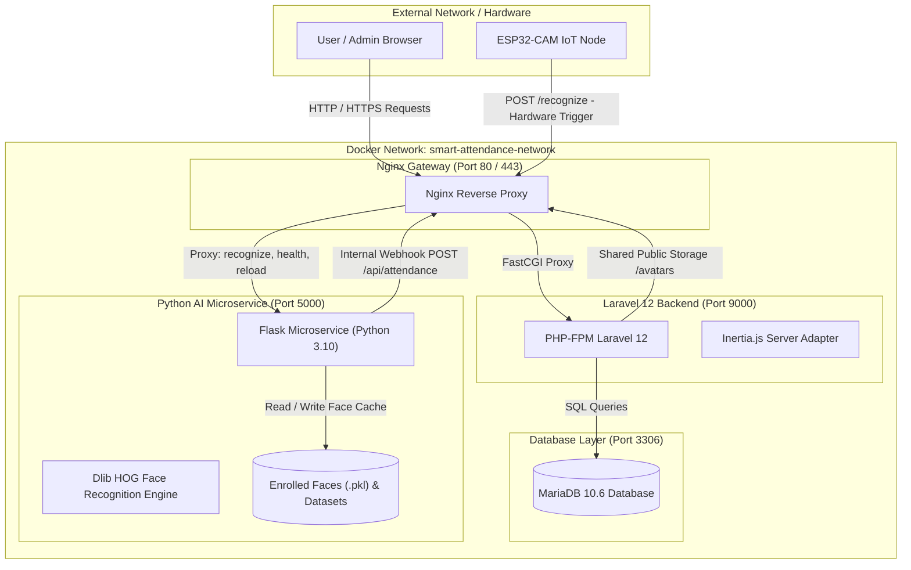

---

### 2. Biometric Attendance Sequence Flow

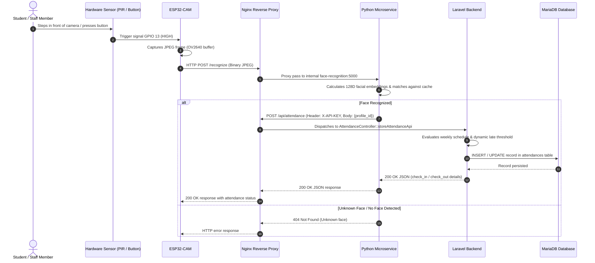

---

### 3. Dynamic Late Attendance Calculation Flowchart

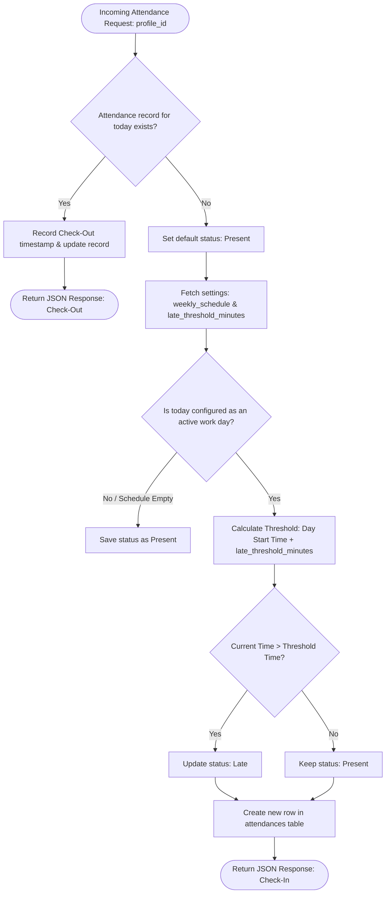

---

### 4. ESP32-CAM Hardware Execution Loop

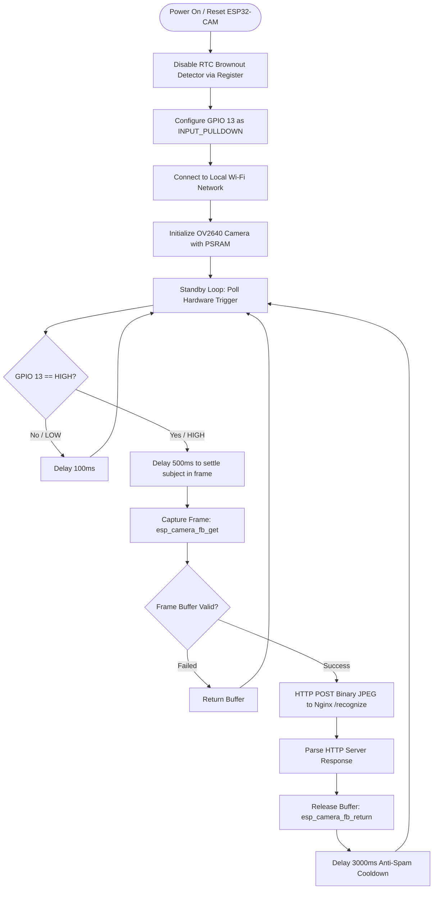

---

### 5. Role-Based Access Control (RBAC) Use Case Diagram

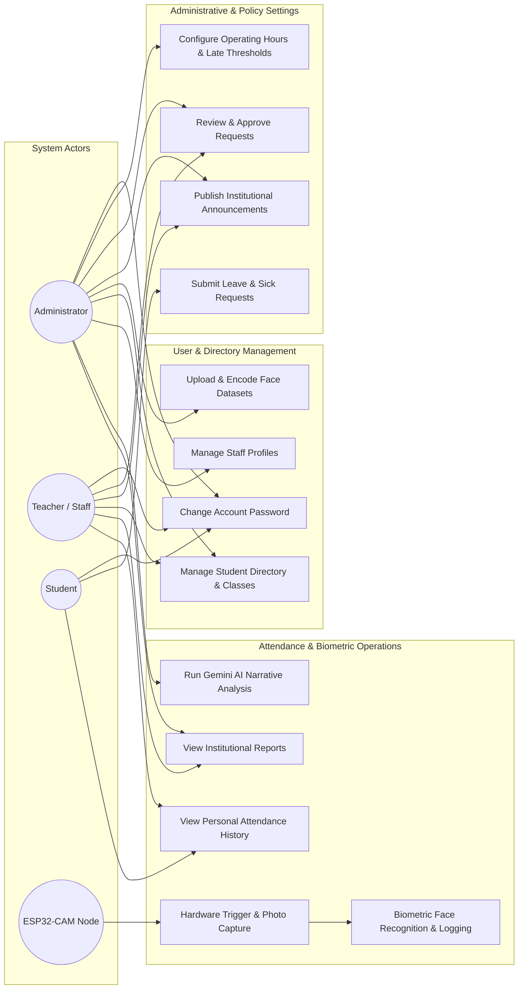

---

## 📊 Database Schema (Entity Relationship Diagram)

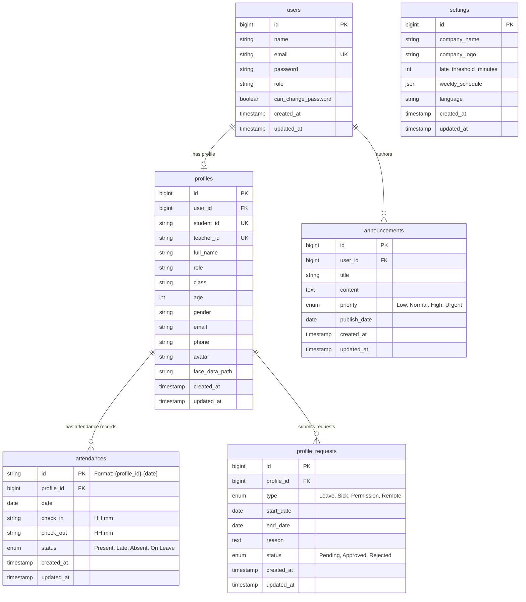

---

## 🛠️ Technology Stack

| Component | Technology | Version | Purpose |
| :--- | :--- | :--- | :--- |
| **Backend** | **Laravel** | `12.x` | Core PHP framework, API logic, Eloquent ORM, and RBAC. |
| **Frontend** | **React** | `19.2` | Component-based UI powered by Vite 6 build pipeline. |
| **Bridge** | **Inertia.js** | `2.3` | Modern monolith adapter connecting Laravel controllers to React views. |
| **UI Styling** | **Tailwind CSS** | `4.1` | Modern utility-first styling with dynamic color variables and dark mode. |
| **Notifications** | **Sonner** | `2.0` | Accessible, rich-stack toast notification engine. |
| **Database** | **MariaDB / MySQL** | `10.6 / 8.0` | Relational storage for profiles, attendances, requests, and schedules. |
| **Recognition Service** | **Python (Flask)** | `3.10` | Face recognition microservice using `face_recognition`, Dlib, and OpenCV. |
| **AI Insights** | **Google GenAI** | `1.42` | Generative attendance summaries and performance insights. |
| **Hardware** | **ESP32-CAM** | - | Low-power IoT camera device with hardware trigger and Wi-Fi streaming. |
| **Web Server / Proxy** | **Nginx** | `Alpine` | High-performance reverse proxy routing HTTP/HTTPS and internal microservices. |
| **Containerization** | **Docker** | `27.x+` | Multi-container Docker Compose orchestration with log rotation. |

---

## 🐳 Docker Architecture & Quick Start (Recommended)

Docker Compose networks the PHP webserver, Nginx proxy, MariaDB database, and Python Face Recognition service into an isolated bridge network (`smart-attendance-network`).

### 1. Clone & Configure Environment

```bash
git clone https://github.com/hilal06/smart-attendanceESP32.git
cd smart-attendanceESP32
cp .env.example .env
```

Open `.env` and verify the core variables:
```ini
APP_ENV=production
APP_DEBUG=false
APP_URL=http://localhost

# Database (Must match the Docker service name 'db')
DB_CONNECTION=mysql
DB_HOST=db
DB_PORT=3306
DB_DATABASE=smart_attendance
DB_USERNAME=smart_user
DB_PASSWORD=secure_password

# Authentication & API Keys
API_KEY=your_secure_random_api_key_here
VITE_GEMINI_API_KEY=your_gemini_api_key_here
```

### 2. Build and Launch Containers

#### Production Mode:
```bash
docker compose -f docker-compose.prod.yml up -d --build
```

#### Development Mode:
```bash
docker compose up -d --build
```

### 3. Initialize the Application (First-time Run)

```bash
# 1. Generate Laravel application key
docker compose -f docker-compose.prod.yml exec app php artisan key:generate

# 2. Symlink public storage for avatar and face uploads
docker compose -f docker-compose.prod.yml exec app php artisan storage:link

# 3. Run database migrations
docker compose -f docker-compose.prod.yml exec app php artisan migrate --force

# 4. Seed initial roles, permissions, and default accounts
docker compose -f docker-compose.prod.yml exec app php artisan db:seed --force
```

### 4. Default Seeded Credentials

| Role | Email | Password | Access Level |
| :--- | :--- | :--- | :--- |
| **Admin** | `admin@smart.com` | `password123` | Full administrative control, settings, directory, and analytics |
| **Teacher** | `teacher1@smartattend.com` | `password123` | Attendance reporting, request approvals, announcements |
| **Student** | `student1@smartattend.com` | `password123` | Personal attendance tracking, requests submission |

*(Additional accounts seeded: `teacher1` through `teacher6`, `student1` through `student20`)*

### 5. Docker Features & Operations
* **Security Behind Reverse Proxy**: The Python microservice (port 5000) is **not** exposed to the public internet directly. All routes (`/recognize`, `/register_face`, `/reload`, `/health`) are safely proxied through Nginx on port 80/443.
* **Log Rotation**: All containers use the `json-file` logging driver with `max-size: 10m` and `max-file: 3` to prevent disk saturation.
* **Volume Persistence**:
  * `dbdata`: Persistent MariaDB storage.
  * `./storage`: Uploaded avatars and system files.
  * `./public/build`: Frontend pre-built production assets.
  * `./python_service/known_faces`: Uploaded dataset images for facial encoding.
  * `./python_service/uploads`: Image capture history for auditing.

---

## 💻 Manual Setup (Local Development without Docker)

**Prerequisites**: PHP 8.2+, Composer 2+, Node.js 20+, MySQL 8.0+, Python 3.10+ (with CMake and Visual C++ Build Tools on Windows).

1. **Clone & Configure**:
   ```bash
   git clone https://github.com/hilal06/smart-attendanceESP32.git
   cd smart-attendanceESP32
   cp .env.example .env
   ```
   Set `DB_HOST=127.0.0.1` and configure local database credentials, `API_KEY`, and `VITE_GEMINI_API_KEY`.

2. **Install Dependencies & Build Assets**:
   ```bash
   composer install
   php artisan key:generate
   php artisan storage:link
   php artisan migrate:fresh --seed
   npm install
   npm run build
   ```

3. **Start Development Servers**:
   ```bash
   # Terminal 1 - Laravel & Vite Frontend
   composer run dev

   # Terminal 2 - Python Face Recognition Service
   cd python_service
   python -m venv venv
   source venv/bin/activate  # (On Windows: venv\Scripts\activate)
   pip install -r requirements.txt
   python app.py
   ```

---

## 📷 ESP32-CAM Hardware Configuration

1. **Firmware Sketch**: Located at `esp32-cam/CaptureAndUpload.ino` with configurations in `esp32-cam/Config.h`.
2. **Wi-Fi & Server URL**:
   ```cpp
   const char* ssid = "YOUR_WIFI_SSID";
   const char* password = "YOUR_WIFI_PASSWORD";
   const char* serverUrl = "http://192.168.1.100/recognize"; // Port 80 via Nginx proxy
   #define TRIGGER_PIN 13                                   // PIR Sensor or Button
   ```
3. **Brownout Mitigation**: Firmware programmatically disables the brownout detector via RTC control registers to ensure continuous frame streaming under current spikes.

---

## 📡 API Reference & Endpoints

### 1. ESP32 Capture Endpoint
* **URL**: `POST /recognize`
  * *Docker Production*: `http://<SERVER_IP>/recognize`
  * *Local Dev*: `http://localhost:5000/recognize`
* **Body**: Multipart form data with file field `image` or raw binary image data.

### 2. Service Health & Status
* **URL**: `GET /health`
  * *Docker Production*: `http://<SERVER_IP>/health`
  * *Local Dev*: `http://localhost:5000/health`
* **Response**:
  ```json
  {
    "status": "online",
    "face_rec_available": true,
    "loaded_faces_count": 28
  }
  ```

### 3. Face Encoding Cache Reload
* **URL**: `GET /reload`
  * *Docker Production*: `http://<SERVER_IP>/reload`
  * *Local Dev*: `http://localhost:5000/reload`
* **Response**: Triggers an in-memory re-index of all facial images in the `known_faces` directory and updates `known_faces.pkl`.

### 4. Internal Attendance Webhook (Laravel)
* **URL**: `POST /api/attendance`
* **Headers**:
  * `Content-Type: application/json`
  * `X-API-KEY: <API_KEY>` (Configured in `.env`)
* **Body**:
  ```json
  {
    "profile_id": 1
  }
  ```
* **Response**:
  ```json
  {
    "status": "success",
    "type": "check_in",
    "message": "Selamat datang! Check-in tercatat pada 07:45",
    "data": { ... }
  }
  ```

---

## 📂 Project Structure

```text
smart-attendanceESP32/
├── app/                          # Laravel application core
│   ├── Http/Controllers/        # Attendance, Profile, and Settings controllers
│   ├── Http/Middleware/         # ApiKey and RBAC middleware
│   └── Models/                  # Attendance, Profile, User, Setting models
├── database/                     # Migrations and seeders
├── docker/                       # Docker container configurations
│   ├── certbot/                 # Let's Encrypt SSL configuration
│   ├── nginx/                   # Nginx reverse proxy configuration & Dockerfile
│   │   └── conf.d/app.conf      # Virtual host routing & Python proxy rules
│   ├── Dockerfile               # Multi-stage PHP 8.3 FPM container build
│   └── entrypoint.sh            # Production cache & migration entrypoint
├── documentation/                # Dedicated technical guides & manuals
│   ├── DEVELOPER_GUIDE.md        # Comprehensive technical manual (SDLC, diagrams, DB, API)
│   ├── DEPLOYMENT.md             # Production Docker deployment & server setup
│   ├── SETUP_LOCAL.md            # Local development environment setup
│   ├── SETUP_ESP32.md            # ESP32-CAM wiring, flashing & hardware trigger
│   ├── RBAC_IMPLEMENTATION_GUIDE.md # Spatie RBAC & permission matrix
│   ├── FUTURE_MQTT_GUIDE.md      # MQTT architecture & IoT scaling guide
│   ├── ROADMAP.md                # Project development roadmap
│   └── screenshots/              # Application UI showcases & captures
├── esp32-cam/                    # ESP32-CAM C++ firmware & config
│   ├── CaptureAndUpload.ino     # Capture loop & trigger logic
│   └── Config.h                 # Wi-Fi credentials & endpoint URL
├── python_service/               # Python Face Recognition Microservice
│   ├── Dockerfile               # Python 3.10 + dlib container build
│   ├── app.py                   # Flask API, Dlib recognition & Laravel client
│   ├── known_faces/             # Enrolled facial images
│   ├── uploads/                 # Capture audit history
│   └── requirements.txt         # Python dependencies
├── resources/                    # React Frontend
│   ├── css/app.css              # Theme CSS tokens, dark mode, animations
│   ├── js/                      # TypeScript frontend application
│   │   ├── Components/          # Shared modular components
│   │   │   └── DashboardVariants/# 5 Specialized Dashboard Styles
│   │   ├── Layouts/             # AppLayout, navigation, header
│   │   ├── Pages/               # Inertia page views (Dashboard, Profiles, Reports, Settings)
│   │   └── constants.ts         # Bilingual (ID/EN) strings and dictionary
│   └── views/app.blade.php      # Main HTML entrypoint with theme injection
├── storage/app/public/           # Persistent storage (avatars, attachments)
├── docker-compose.yml           # Local development multi-container orchestration
├── docker-compose.prod.yml      # Production multi-container orchestration
└── tailwind.config.js           # Tailwind CSS configuration with dynamic palettes
```

---

## 📚 Documentation & Guides

Detailed technical guides and manuals are organized inside the **[`documentation/`](documentation/)** directory:

* 📘 **[Developer Guide (Comprehensive Technical Manual)](documentation/DEVELOPER_GUIDE.md)** — Full technical documentation covering SDLC, architecture & sequence diagrams, use cases, database ERD & data dictionary, API specifications, and troubleshooting.
* 📖 **[Production Deployment Guide](documentation/DEPLOYMENT.md)** — Step-by-step production deployment using Docker Compose, Nginx reverse proxy, and MariaDB.
* 💻 **[Local Development Setup](documentation/SETUP_LOCAL.md)** — Manual local setup for PHP 8.2+, Node.js, and Python microservice.
* 📷 **[ESP32-CAM Setup & Hardware Wiring](documentation/SETUP_ESP32.md)** — Flashing firmware, hardware trigger wiring, and brownout mitigation.
* 🔐 **[RBAC Implementation Guide](documentation/RBAC_IMPLEMENTATION_GUIDE.md)** — Multi-tier roles, permissions, and security hierarchy.
* 📡 **[Future MQTT Architecture](documentation/FUTURE_MQTT_GUIDE.md)** — Migration plan for enterprise IoT scale using MQTT broker.
* 🗺️ **[Project Roadmap](documentation/ROADMAP.md)** — Milestones and future roadmap.

---

## 📄 License

This project is open-sourced under the [MIT license](https://opensource.org/licenses/MIT).