# Dokumentasi Pengembang SmartAttend (Developer Guide)

Dokumen ini ditujukan sebagai referensi teknis komprehensif bagi perekayasa perangkat lunak (software engineer) dan tim DevOps yang mengelola, mengembangkan, serta memelihara sistem **SmartAttend**.

---

## Daftar Isi
1. [Gambaran Umum Proyek](#1-gambaran-umum-proyek)
2. [Siklus Hidup Pengembangan Perangkat Lunak (SDLC)](#2-siklus-hidup-pengembangan-perangkat-lunak-sdlc)
3. [Arsitektur Sistem & Aliran Data](#3-arsitektur-sistem--aliran-data)
4. [Diagram Use Case & Analisis Pengguna](#4-diagram-use-case--analisis-pengguna)
5. [Skema Database & Kamus Data](#5-skema-database--kamus-data)
6. [Spesifikasi API & Protokol Komunikasi](#6-spesifikasi-api--protokol-komunikasi)
7. [Struktur Direktori & Berkas Penting](#7-struktur-direktori--berkas-penting)
8. [Panduan Setup Pengembang (Lokal & Produksi)](#8-panduan-setup-pengembang-lokal--produksi)
9. [Galeri Antarmuka Sistem (Showcase)](#9-galeri-antarmuka-sistem-showcase)
10. [Penanganan Masalah & Pemeliharaan (Troubleshooting)](#10-penanganan-masalah--pemeliharaan-troubleshooting)

---

## 1. Gambaran Umum Proyek

**SmartAttend** adalah platform terintegrasi manajemen kehadiran biometrik nirkontak (*contactless biometric attendance*) yang dirancang untuk lingkungan instansi pendidikan dan perkantoran. Sistem ini menghubungkan perangkat IoT **ESP32-CAM**, layanan mikro pengenalan wajah (*face recognition microservice*) berbasis Python, backend monolitik **Laravel 12**, dan antarmuka web reaktif **React 19** melalui jembatan **Inertia.js v2**.

### Komponen Inti:
1. **IoT Sensor & Capture Node**: ESP32-CAM dengan modul sensor gerak PIR / tombol fisik (hardware trigger) untuk menangkap citra wajah tanpa saturasi jaringan.
2. **AI Microservice**: Layanan Python berbasis Flask dan library `face_recognition` (dlib HOG + OpenCV) yang membandingkan vektor wajah 128D dengan dataset tersimpan.
3. **Core Application**: Backend Laravel 12 yang menangani logika bisnis, perhitungan status keterlambatan dinamis berdasarkan hari kerja, autentikasi berbasis sesi dan token, serta manajemen data.
4. **Client Interface**: Single Page Application (SPA) reaktif berbasis React 19, TypeScript, dan Tailwind CSS v4 tanpa latensi navigasi berkat Inertia.js.
5. **Reverse Proxy & Gateway**: Nginx Alpine yang mengamankan komunikasi internal dan menyajikan aset statis.

---

## 2. Siklus Hidup Pengembangan Perangkat Lunak (SDLC)

Pengembangan sistem SmartAttend menggunakan pendekatan **Iterative Agile** yang dikombinasikan dengan strategi percabangan **Trunk-Based Development**.

### 2.1 Alur Kerja Git & Percabangan
* **Branch Utama (`main`)**: Berisi kode yang siap untuk rilis produksi dan telah divalidasi.
* **Feature Branches (`feat/...` atau `fix/...`)**: Dibuat dari `main` untuk penambahan modul atau perbaikan bug.
* **Commit Messages**: Mengikuti standar *Conventional Commits*:
  * `feat:` Penambahan fitur baru.
  * `fix:` Perbaikan bug.
  * `refactor:` Restrukturisasi kode tanpa mengubah perilaku eksternal.
  * `docs:` Perubahan dokumentasi.
  * `chore:` Pemeliharaan dependensi atau konfigurasi container.

### 2.2 Tahapan Pengembangan (Lifecycle)
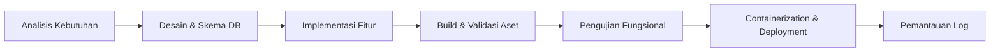

1. **Analisis Kebutuhan**: Memastikan konsistensi tipe data antara model Laravel, skema TypeScript, dan microservice Python.
2. **Desain & Migrasi**: Penulisan file migrasi Laravel di `database/migrations/` dan pembaruan seeder di `database/seeders/`.
3. **Implementasi**:
   * Penulisan controller dan middleware di `app/Http/`.
   * Pembuatan komponen antarmuka modular di `resources/js/Components/`.
4. **Build & Validasi Aset**: Eksekusi `npm run build` untuk memverifikasi tidak adanya kesalahan kompilasi TypeScript atau CSS.
5. **Pengujian Fungsional**: Pengujian skenario login, pendaftaran profil, simulasi unggah wajah, dan logging presensi.
6. **Deployment**: Pembuatan image Docker dan orkestrasi container menggunakan `docker compose`.
7. **Pemantauan**: Evaluasi log Nginx, PHP-FPM, dan output microservice melalui rotasi file log Docker.

---

## 3. Arsitektur Sistem & Aliran Data

### 3.1 Diagram Arsitektur Komponen

```mermaid
graph TD
    subgraph Klien_Eksternal ["Perangkat Luar Jaringan"]
        Browser["Peramban Klien (Pengguna / Admin)"]
        ESP32["Hardware ESP32-CAM Node"]
    end

    subgraph Container_Docker ["Lingkungan Docker Bridge (smart-attendance-network)"]
        subgraph Webserver_Gateway ["Nginx Gateway (Port 80/443)"]
            Nginx["Nginx Reverse Proxy"]
        end

        subgraph Backend_App ["Aplikasi Inti Laravel (Port 9000)"]
            Laravel["PHP-FPM Laravel 12 Backend"]
            Inertia["Inertia.js V2 Server Adapter"]
        end

        subgraph Database_Layer ["Penyimpanan Relasional (Port 3306)"]
            MariaDB[("MariaDB 10.6 Database")]
        end

        subgraph Microservice_AI ["Mesin Pengenalan Wajah (Port 5000)"]
            Flask["Flask Microservice (Python 3.10)"]
            Dlib["Dlib Face Recognition Engine"]
            FaceStorage[("Cache Encodings (.pkl) & Datasets")]
        end
    end

    Browser -->|HTTP/HTTPS Request| Nginx
    ESP32 -->|POST /recognize (Hardware Trigger)| Nginx

    Nginx -->|FastCGI / Port 9000| Laravel
    Nginx -->|Proxy Pass ^/(recognize|health|reload)| Flask

    Laravel -->|SQL Query| MariaDB
    Flask -->|POST /api/attendance (Header: X-API-KEY)| Nginx
    Flask -->|Baca/Tulis Dataset| FaceStorage
    Laravel -->|Tautkan /storage ke Public| Nginx
```

### 3.2 Diagram Aliran Presensi Wajah (Sequence Diagram)

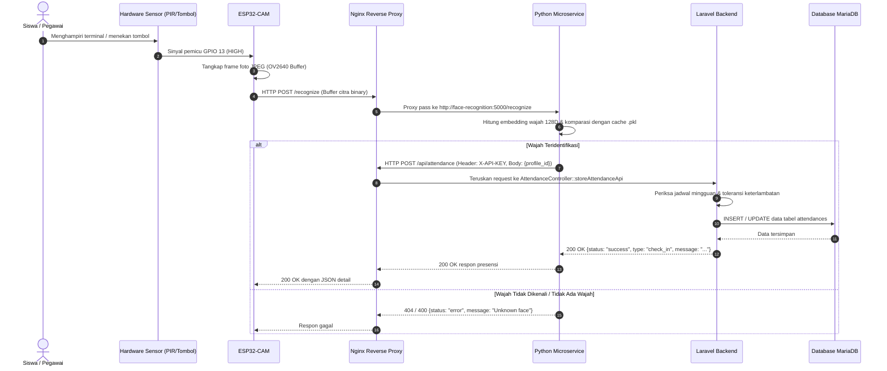

---

## 4. Diagram Use Case & Analisis Pengguna

### 4.1 Aktor Sistem
1. **Administrator**: Pengelola sistem tertinggi yang memiliki akses konfigurasi penuh (jadwal kerja, akun pengajar/siswa, laporan analitik, pengumuman).
2. **Guru / Tenaga Pengajar (Teacher)**: Petugas yang berwenang meninjau kehadiran siswa, menyetujui/menolak permohonan izin/cuti, dan mempublikasikan pengumuman.
3. **Siswa / Pegawai (Student)**: Pengguna mandiri yang melihat catatan kehadiran pribadi dan mengajukan permohonan izin/koreksi kehadiran.
4. **Terminal ESP32-CAM**: Aktor perangkat keras non-manusia yang bertindak sebagai sensor biometrik otomatis.

### 4.2 Diagram Use Case

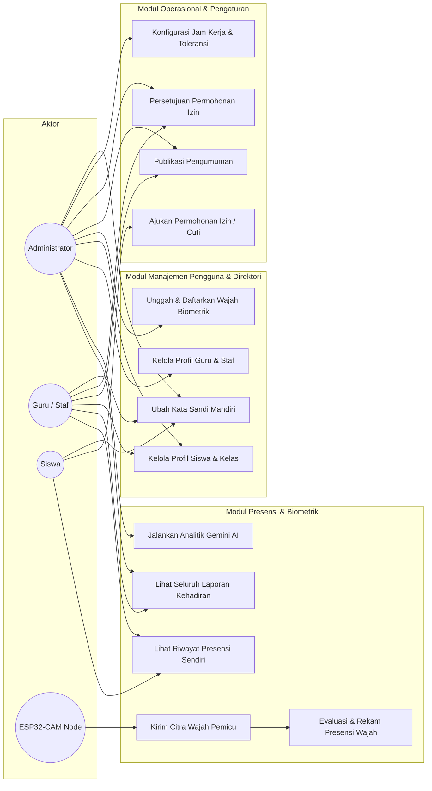

---

## 5. Skema Database & Kamus Data

SmartAttend menggunakan basis data relasional MariaDB / MySQL dengan penomoran relasi antar-entitas sebagai berikut:

### 5.1 Diagram Entity Relationship (ERD)

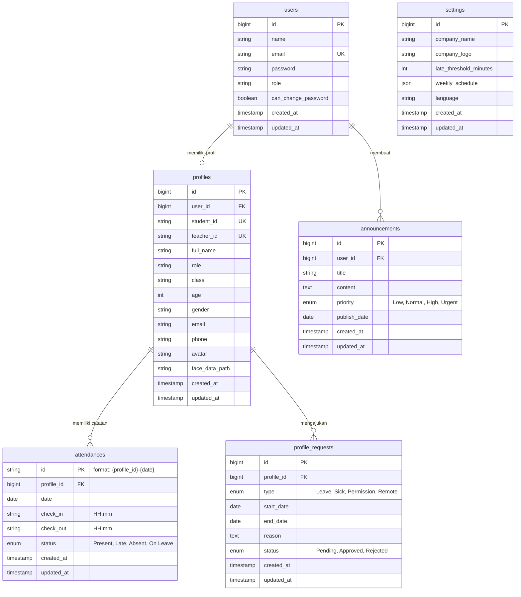

### 5.2 Kamus Data Utama

#### 1. Tabel `users`
Menyimpan kredensial autentikasi web.
* `id` (BIGINT, Primary Key, Auto Increment).
* `name` (VARCHAR 255): Nama akun pengguna.
* `email` (VARCHAR 255, Unique): Alamat surel login.
* `password` (VARCHAR 255): Hash sandi terenkripsi Bcrypt.
* `role` (VARCHAR 50): Label peran dasar (`admin`, `teacher`, `student`).
* `can_change_password` (BOOLEAN, Default: `false`): Izin bagi siswa/staf untuk mengganti sandi akun mereka sendiri.

#### 2. Tabel `profiles`
Menyimpan entitas biodata lengkap guru, siswa, dan staf.
* `id` (BIGINT, Primary Key, Auto Increment).
* `user_id` (BIGINT, Foreign Key -> `users.id`, Nullable): Tautan akun login.
* `student_id` (VARCHAR 50, Unique, Nullable): Nomor Induk Siswa (NIS).
* `teacher_id` (VARCHAR 50, Unique, Nullable): Nomor Induk Pendidik / NIP.
* `full_name` (VARCHAR 255): Nama lengkap resmi.
* `role` (VARCHAR 50): Peran institusi.
* `class` (VARCHAR 50, Nullable): Kelas atau rombel siswa (contoh: `12-RPL-1`).
* `age` (INT, Nullable): Usia dalam tahun.
* `avatar` (VARCHAR 255, Nullable): Lokasi berkas foto avatar di `storage/app/public/avatars/`.
* `face_data_path` (VARCHAR 255, Nullable): Jalur foto rujukan dataset di `python_service/known_faces/`.

#### 3. Tabel `attendances`
Menyimpan riwayat presensi harian per individu.
* `id` (VARCHAR 64, Primary Key): ID komposit berformat `{profile_id}-{YYYY-MM-DD}` guna memastikan integritas idempotensi (1 profil hanya memiliki 1 baris rekam per hari).
* `profile_id` (BIGINT, Foreign Key -> `profiles.id`).
* `date` (DATE): Tanggal presensi (Zona waktu `Asia/Jakarta`).
* `check_in` (VARCHAR 10, Nullable): Waktu masuk format `HH:mm`.
* `check_out` (VARCHAR 10, Nullable): Waktu keluar format `HH:mm`.
* `status` (ENUM): Nilai valid: `'Present'`, `'Late'`, `'Absent'`, `'On Leave'`.

#### 4. Tabel `settings`
Menyimpan konfigurasi global instansi.
* `late_threshold_minutes` (INT, Default: `15`): Waktu toleransi keterlambatan dalam satuan menit setelah jam mulai kerja/sekolah.
* `weekly_schedule` (JSON): Jadwal operasional harian terstruktur:
  ```json
  [
    {"day": "Monday", "isActive": true, "start": "08:00", "end": "16:00"},
    {"day": "Tuesday", "isActive": true, "start": "08:00", "end": "16:00"},
    {"day": "Wednesday", "isActive": true, "start": "08:00", "end": "16:00"},
    {"day": "Thursday", "isActive": true, "start": "08:00", "end": "16:00"},
    {"day": "Friday", "isActive": true, "start": "08:00", "end": "16:00"},
    {"day": "Saturday", "isActive": false, "start": "09:00", "end": "12:00"},
    {"day": "Sunday", "isActive": false, "start": "09:00", "end": "12:00"}
  ]
  ```

---

## 6. Spesifikasi API & Protokol Komunikasi

### 6.1 Endpoint Internal Laravel

#### `POST /api/attendance`
Dipanggil oleh microservice Python saat wajah berhasil dicocokkan.
* **Middleware**: `api.key` (Memeriksa header `X-API-KEY` dengan nilai `API_KEY` pada `.env`).
* **Headers**:
  * `Content-Type: application/json`
  * `X-API-KEY: <SECRET_KEY>`
* **Request Payload**:
  ```json
  {
    "profile_id": 1
  }
  ```
* **Logika Pemrosesan**:
  1. Jika baris `{profile_id}-{hari_ini}` belum ada, sistem membuat entri **Check-in**.
  2. Status ditentukan otomatis: Jika waktu saat ini melebihi `jadwal_mulai + late_threshold_minutes`, status menjadi `Late`. Jika tidak, status adalah `Present`.
  3. Jika baris sudah ada dan `check_out` kosong, request kedua pada hari yang sama akan mencatat waktu **Check-out**.
* **Response (Check-in Baru - 200 OK)**:
  ```json
  {
    "status": "success",
    "type": "check_in",
    "message": "Selamat datang! Check-in tercatat pada 07:45",
    "data": {
      "id": "1-2026-10-12",
      "profile_id": 1,
      "date": "2026-10-12",
      "check_in": "07:45",
      "check_out": null,
      "status": "Present"
    }
  }
  ```

---

### 6.2 Endpoint Microservice Python (`python_service`)

Semua endpoint ini diproksikan secara transparan melalui Nginx pada port 80/443.

#### `POST /recognize`
Menerima citra dari ESP32-CAM dan mencocokkannya dengan database vektor wajah.
* **Headers**: `Content-Type: image/jpeg` (atau multipart/form-data).
* **Body**: Buffer biner citra mentah JPEG.
* **Response Berhasil (200 OK)**:
  ```json
  {
    "status": "success",
    "matched_name": "1",
    "profile_id": 1,
    "laravel_response": {
      "status": "success",
      "type": "check_in"
    }
  }
  ```
* **Response Wajah Tidak Cocok (404 Not Found)**:
  ```json
  {
    "status": "error",
    "message": "Wajah tidak dikenali dalam sistem."
  }
  ```

#### `GET /health`
Digunakan oleh antarmuka dashboard untuk memantau status kesehatan engine secara real-time.
* **Response (200 OK)**:
  ```json
  {
    "status": "online",
    "face_rec_available": true,
    "loaded_faces_count": 28
  }
  ```

#### `GET /reload`
Memaksa microservice memindai ulang folder `known_faces/` dan memperbarui file serialisasi `known_faces.pkl`.
* **Response (200 OK)**:
  ```json
  {
    "status": "success",
    "message": "Enkoding wajah berhasil dimuat ulang.",
    "count": 28
  }
  ```

---

## 7. Struktur Direktori & Berkas Penting

```text
smart-attendanceESP32/
├── app/
│   ├── Http/
│   │   ├── Controllers/
│   │   │   └── AttendanceController.php # Controller utama seluruh proses bisnis
│   │   └── Middleware/
│   │       ├── CheckUserSession.php     # Proteksi sesi pengguna web
│   │       ├── EnsureApiKey.php         # Verifikasi token header X-API-KEY
│   │       └── HandleInertiaRequests.php# Injector props global (auth, flash, theme)
│   └── Models/                          # Model Eloquent (User, Profile, Attendance, dll.)
│
├── database/
│   ├── migrations/                      # Skema DDL tabel relasional
│   └── seeders/                         # Inisialisasi peran Spatie dan akun awal
│
├── docker/
│   ├── nginx/
│   │   ├── conf.d/app.conf              # Blok konfigurasi virtualhost & proxy pass
│   │   └── Dockerfile                   # Multi-stage image Nginx + frontend built
│   ├── certbot/                         # Konfigurasi perpanjangan sertifikat TLS Let's Encrypt
│   ├── Dockerfile                       # Multi-stage build PHP 8.3 FPM
│   └── entrypoint.sh                    # Skrip start container produksi
│
├── documentation/                       # Direktori teknis & panduan resmi
│   ├── screenshots/                     # Tangkapan layar autentik aplikasi
│   ├── DEVELOPER_GUIDE.md               # Dokumen komprehensif developer (berkas ini)
│   ├── DEPLOYMENT.md                    # Prosedur deployment server Ubuntu
│   ├── SETUP_LOCAL.md                   # Petunjuk setup lokal mesin pengembang
│   ├── SETUP_ESP32.md                   # Spesifikasi teknis & perakitan hardware
│   ├── RBAC_IMPLEMENTATION_GUIDE.md     # Hierarki hak akses Spatie Permission
│   ├── FUTURE_MQTT_GUIDE.md             # Dokumen teknis rencana transisi MQTT
│   └── ROADMAP.md                       # Daftar pencapaian & rencana pengembangan
│
├── esp32-cam/
│   ├── CaptureAndUpload.ino             # Firmware C++ ESP32-CAM dengan sensor trigger
│   └── Config.h                         # Berkas konfigurasi WiFi, server URL, dan pin
│
├── python_service/
│   ├── app.py                           # Aplikasi Flask pengenalan wajah & proxy webhook
│   ├── Dockerfile                       # Image container Python 3.10 + build dlib
│   ├── known_faces/                     # Direktori penyimpanan citra referensi profil
│   ├── uploads/                         # Audit trail rekaman citra dari kamera
│   └── requirements.txt                 # Dependensi Python (face_recognition, opencv, flask)
│
├── resources/
│   ├── css/app.css                      # Token variabel CSS tema dan styling Tailwind v4
│   ├── js/
│   │   ├── Components/
│   │   │   ├── DashboardVariants/       # 5 Varian antarmuka spesifik peran
│   │   │   │   ├── AcademicStudioDashboard.tsx
│   │   │   │   ├── CommandCenterDashboard.tsx
│   │   │   │   ├── NordicMinimalDashboard.tsx
│   │   │   │   ├── KioskMonitorDashboard.tsx
│   │   │   │   └── StatusWorkspaceDashboard.tsx
│   │   │   ├── Can.tsx                  # Komponen pembungkus otorisasi berbasis izin
│   │   │   ├── Reports.tsx              # Tampilan tabular & visual analitik
│   │   │   └── Sidebar.tsx              # Navigasi utama dengan seleksi peran
│   │   ├── Pages/                       # Layar Inertia (Dashboard, Login, Settings, dll.)
│   │   └── constants.ts                 # Kamus lokalisasi dwibahasa (ID / EN)
│   └── views/app.blade.php              # Shell HTML utama Laravel dengan proteksi FOUC
│
├── docker-compose.yml                   # Orkestrasi lokal pengembang multi-layanan
├── docker-compose.prod.yml              # Orkestrasi produksi dengan isolasi jaringan
└── tailwind.config.js                   # Konfigurasi sistem palet warna dan animasi
```

---

## 8. Panduan Setup Pengembang (Lokal & Produksi)

### 8.1 Setup Cepat Produksi (Docker Compose)

Untuk menyebarkan aplikasi pada server produksi Ubuntu atau lingkungan Docker lokal:

```bash
# 1. Salin berkas lingkungan
cp .env.example .env

# 2. Sesuaikan berkas .env
# Set DB_HOST=db, API_KEY=secret_key, APP_ENV=production

# 3. Bangun dan jalankan seluruh container
docker compose -f docker-compose.prod.yml up -d --build

# 4. Inisialisasi kunci aplikasi dan symlink penyimpanan
docker compose -f docker-compose.prod.yml exec app php artisan key:generate
docker compose -f docker-compose.prod.yml exec app php artisan storage:link

# 5. Jalankan migrasi dan seeder database
docker compose -f docker-compose.prod.yml exec app php artisan migrate --force
docker compose -f docker-compose.prod.yml exec app php artisan db:seed --force
```

### 8.2 Perintah Operasional Docker yang Sering Digunakan

* **Melihat status dan penggunaan memori container**:
  ```bash
  docker compose -f docker-compose.prod.yml ps
  docker stats --no-stream
  ```
* **Melihat log real-time microservice Python**:
  ```bash
  docker compose -f docker-compose.prod.yml logs -f face-recognition
  ```
* **Memuat ulang encoding wajah tanpa restart container**:
  ```bash
  curl http://localhost/reload
  ```
* **Menghentikan seluruh container dengan aman**:
  ```bash
  docker compose -f docker-compose.prod.yml down
  ```

---

## 9. Galeri Antarmuka Sistem (Showcase)

Berikut adalah dokumentasi visual antarmuka sistem SmartAttend yang diambil langsung dari lingkungan operasional:

### 9.1 Autentikasi & Registrasi

| Gerbang Masuk Terpadu (Login Gateway) | Pendaftaran Akun & Pengukur Sandi |
| :---: | :---: |
| 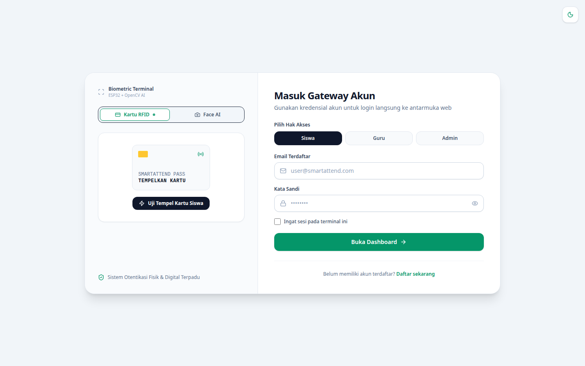 | 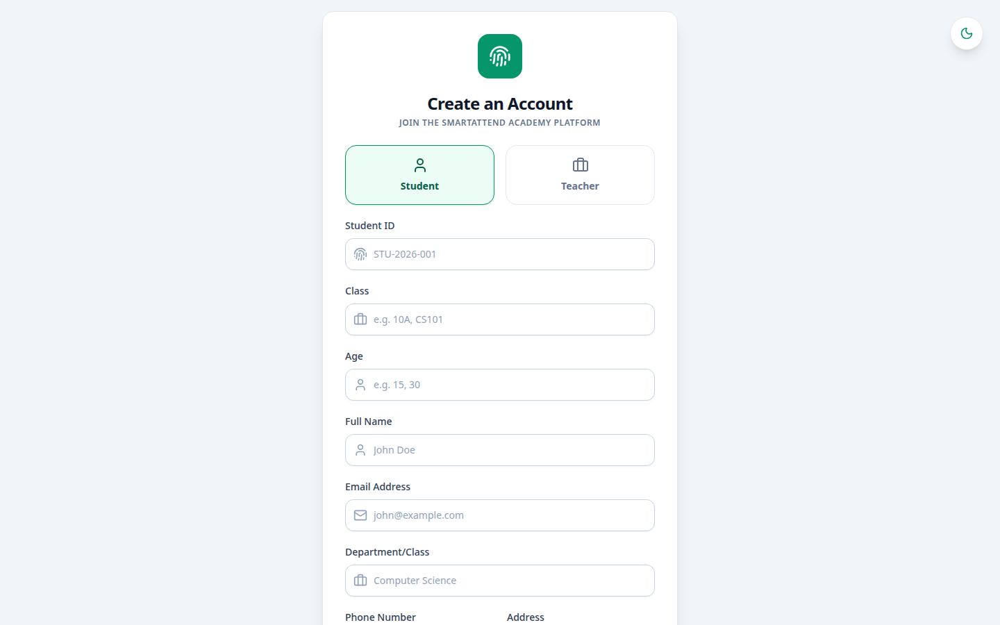 |
| *Mendukung autentikasi kartu fisik RFID dan akun kata sandi dengan deteksi tema.* | *Dilengkapi indikator kekuatan kata sandi zxcvbn dan pemilihan peran.* |

---

### 9.2 Dasbor Operasional

| Dasbor Studio Akademik (Academic Studio) | Direktori Staf & Pendaftaran Biometrik |
| :---: | :---: |
| 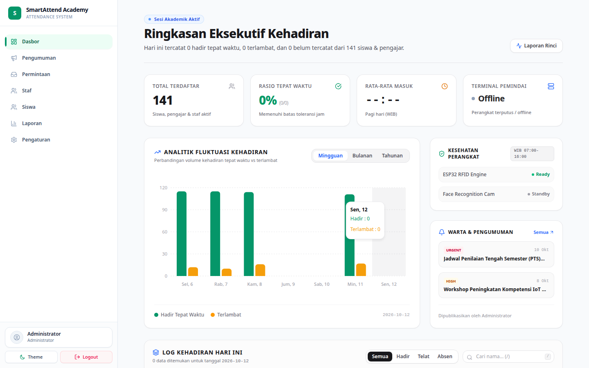 | 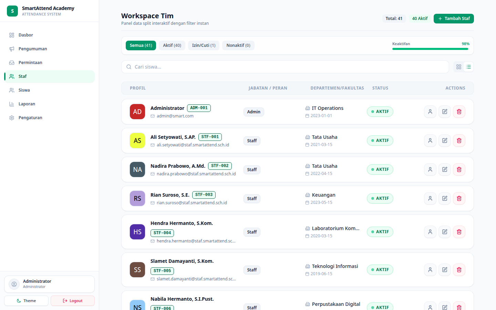 |
| *Visualisasi fluktuasi mingguan, status kesehatan terminal, dan ringkasan eksekutif.* | *Manajemen data pengajar, foto rujukan biometrik, dan sinkronisasi hak akses.* |

---

### 9.3 Manajemen Siswa & Analitik Laporan

| Direktori Siswa & Kelas | Laporan Kehadiran & Asisten Analitik AI |
| :---: | :---: |
| 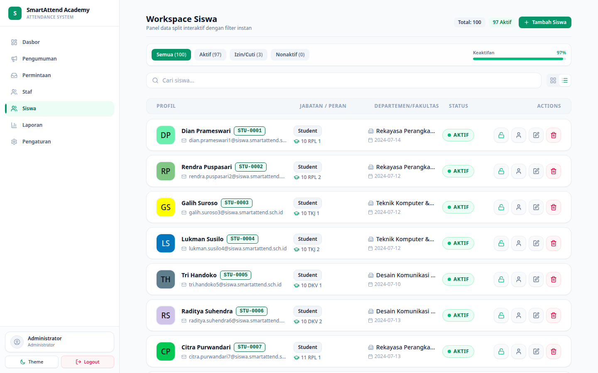 | 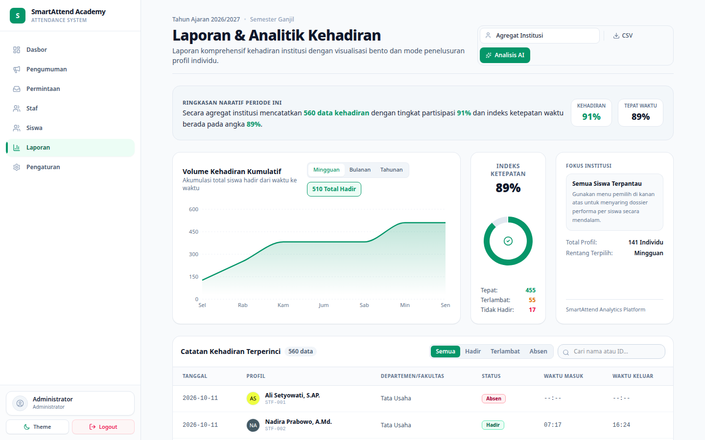 |
| *Pencarian cepat, penugasan rombel kelas, dan evaluasi status kehadiran harian.* | *Analisis tren kumulatif, indeks ketepatan waktu, dan integrasi Google Gemini AI.* |

---

### 9.4 Operasional & Pengaturan Institusi

| Manajemen Pengajuan Izin / Cuti | Warta & Papan Pengumuman Institusi |
| :---: | :---: |
|  |  |
| *Alur persetujuan surat sakit, cuti, atau izin dengan pelacakan status transparan.* | *Pusat pengumuman dengan tanda prioritas (Urgent, High, Normal) untuk seluruh pengguna.* |

| Konfigurasi Jam Kerja & Toleransi | Pengaturan Profil Pengguna Mandiri |
| :---: | :---: |
| 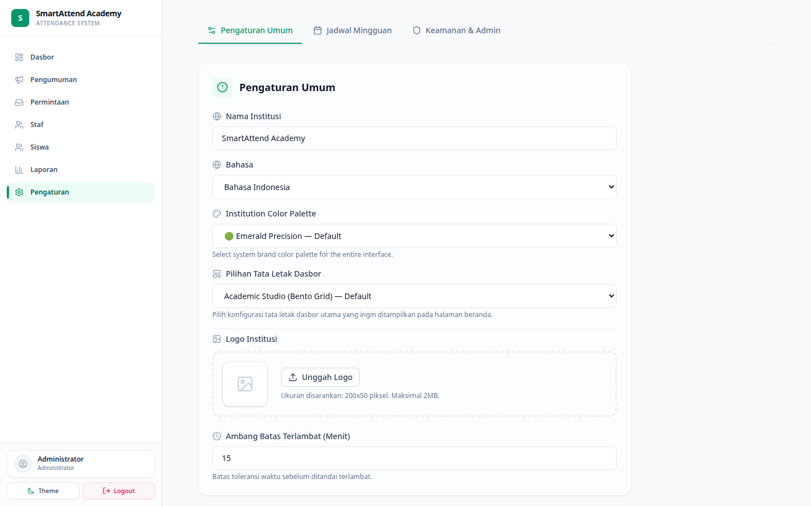 |  |
| *Pengaturan ambang batas keterlambatan harian dan jadwal aktif mingguan.* | *Informasi akun personal dan mekanisme pembaruan kata sandi berkeamanan tinggi.* |

---

## 10. Penanganan Masalah & Pemeliharaan (Troubleshooting)

### 1. Layanan Pengenalan Wajah Berstatus 'Offline' pada Dasbor
* **Penyebab**: Microservice Python belum aktif atau crash karena kegagalan kompilasi dependensi `dlib`.
* **Solusi**:
  1. Periksa log container:
     ```bash
     docker compose -f docker-compose.prod.yml logs --tail=50 face-recognition
     ```
  2. Pastikan file model `.pkl` dapat ditulis dan izin direktori `known_faces/` serta `uploads/` dapat diakses oleh proses Python.
  3. Uji endpoint secara langsung:
     ```bash
     curl http://localhost/health
     ```

### 2. Tampilan Antarmuka Kosong (Blank Page) atau Aset Vite Hilang
* **Penyebab**: File `public/hot` tertinggal dari sesi dev lokal atau aset bundel produksi belum dikompilasi.
* **Solusi**:
  1. Hapus file `public/hot` jika tidak sedang menjalankan `npm run dev`:
     ```bash
     rm -f public/hot
     ```
  2. Jalankan build ulang aset:
     ```bash
     npm run build
     ```
  3. Jika menggunakan Docker, pastikan direktori `./public/build` ter-mount dengan benar ke container Nginx dan App.

### 3. Foto Profil atau Avatar Tidak Muncul (HTTP 404)
* **Penyebab**: Tautan simbolik (*symlink*) antara `storage/app/public` dan `public/storage` belum dibuat.
* **Solusi**:
  Jalankan perintah Artisan di dalam container aplikasi:
  ```bash
  docker compose -f docker-compose.prod.yml exec app php artisan storage:link
  ```

### 4. ESP32-CAM Mengalami Reset Terus-Menerus (Brownout Reset)
* **Penyebab**: Catu daya USB tidak stabil atau arus listrik drop saat radio WiFi dan sensor kamera aktif bersamaan.
* **Solusi**:
  1. Gunakan adaptor daya 5V dengan arus minimal 2 Ampere.
  2. Pastikan baris kode penonaktifan detektor brownout aktif di `esp32-cam/CaptureAndUpload.ino`:
     ```cpp
     WRITE_PERI_REG(RTC_CNTL_BROWN_OUT_REG, 0);
     ```
  3. Pasang kapasitor elektrolit 100uF - 470uF di antara pin 5V dan GND pada modul ESP32-CAM untuk meredam fluktuasi arus.
